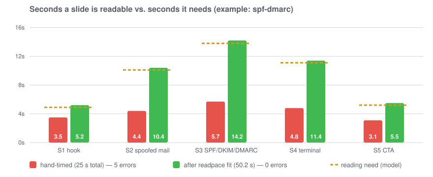

# readpace

**Measured slide timing for [HyperFrames](https://hyperframes.heygen.com) compositions.**

> Status: 0.1 — early. Works on single-file compositions; see [Limitations](#limitations).

`readpace` plays your composition in headless Chromium, measures when each block of text is actually readable, simulates a viewer reading it, and tells you which slides disappear before anyone could finish them. It can then re-time the scenes for you, and calibrate its reading model against real people.

```
$ readpace check examples/spf-dmarc
Uncalibrated: default reading rates (estimates). Calibrate with `readpace calibrate`.

scene             time  factor    need  readable   late    idle
s1_a           0.0–4.2    1.00    4.9s      3.5s   1.4s    0.0s ✗
s2_a           4.2–9.2    1.00   10.1s      4.4s   2.8s    0.0s ✗
s3_a          9.2–15.5    1.00   13.8s      5.7s   2.1s    0.0s ✗
s4_a         15.5–20.8    1.00   11.1s      4.8s   2.9s    0.0s ✗
s5_a         20.8–25.0    1.00    5.2s      3.1s   2.0s    0.0s ✗

ERROR    s2_a   3/5 blocks not finished, up to 2.8 s late. First: "Urgent: please pay the invoice today. Ne" needs 3.5 s, readable 4.6–9.0 s
…
```



> readpace is an independent community tool that works with HyperFrames. It is not affiliated with or endorsed by HeyGen.

## Why

Slide durations are usually set by feel: *every scene gets five seconds*. That is a guess. In the bundled example, timed by hand the usual way, **every one of the five slides** leaves the screen 1.4–2.9 s before the default (uncalibrated) reading model has finished it — and `readpace calibrate` lets you check that model against real readers.

The idea is borrowed from [*Time Is Not Metadata*](https://github.com/Jeuners/Time_Dilation_in_LLM_Agent_Systems): in a randomised delegation experiment, LLM agents given measured peer latencies chose the cost-favoured delegate in 100 of 100 trials, against 55 of 100 without. Timing should be measured, not assumed (see [Background](#background)).

## Quick start

Requires Node ≥ 22 and a Chrome/Chromium binary (auto-detected from Puppeteer's or Playwright's cache, system Chrome, or `CHROME_PATH`). readpace is not on npm yet; run it straight from GitHub:

```bash
npx github:Jeuners/readpace check path/to/composition       # which slides are too short?
npx github:Jeuners/readpace fit   path/to/composition       # dry run: proposed timing
npx github:Jeuners/readpace fit   path/to/composition --write
npx github:Jeuners/readpace calibrate path/to/composition   # measure your own reading speed
```

or clone it and use `node bin/readpace.js …` (the examples below write `readpace` for short). No Chrome yet? `npx @puppeteer/browsers install chrome-headless-shell@stable`

## Commands

| Command | What it does |
|---|---|
| `readpace check [dir]` | Measures every scene. Exit code 1 on errors (`--strict`: also on warnings), so it fits into CI next to `hyperframes check`. `--json` for machine-readable output. |
| `readpace fit [dir]` | Lengthens each scene by the time it lacks (its overrun) plus 0.3 s, shortens idle ones, shifts the rest, re-measures until stable. Measures a scratch copy; `index.html` is only touched with `--write` (backup: `index.html.bak`). Requires the [scene convention](#scene-convention). |
| `readpace calibrate [dir]` | Plays the composition slide by slide in your browser; you press <kbd>Space</kbd> when you have finished reading. Produces a calibration factor *k* with spread and age. |
| `readpace calibration` | Shows the current calibration. |

Options: `--wps`, `--wps-head`, `--cps-mono` override reading rates, `--no-calibration` ignores *k*, `--step` sets the sampling step (default 0.1 s), `--rounds` caps fit rounds (default 3). Exit codes: 0 ok, 1 slides too short (`check`), 2 usage or runtime error. See `readpace --help`.

## How it works

1. **Probe.** The composition is loaded in headless Chromium and every registered GSAP timeline in `window.__timelines` is seeked in 0.1 s steps. A *reading block* is the nearest non-inline ancestor of a text node. A block is *readable* at time *t* when all enclosing clips (`data-start`/`data-duration`) are active, its cumulative opacity is ≥ 0.85, it is inside the frame, and its text is complete — typewriter effects count from the last character.
2. **Model.** Each block has a reading cost: words ÷ 3.0 words/s for body text, ÷ 3.5 for headlines (≥ 72 px), non-space characters ÷ 15/s for monospace, plus 0.15 s per block and 0.4 s orientation per scene. These are [estimates until calibrated](docs/reading-model.md).
3. **Viewer simulation.** A simulated viewer reads the blocks of a scene in order of appearance and starts a block once it is readable and the previous one is finished. Per scene readpace reports:
   - **late (deficit):** how long after a block disappears the viewer would finish it,
   - **overrun:** how much time the scene lacks if the viewer were allowed to finish everything — this is what `fit` adds (the deficit alone underestimates it, because an abandoned block frees the viewer early),
   - **idle:** how long the scene stays up after everything has been read.

Details: [docs/how-it-works.md](docs/how-it-works.md).

## Scene convention

`fit` changes only two numbers per scene. For that to be safe, a scene must read its own window from its attributes, with entrances relative to its start and the exit relative to its end:

```html
<div id="s1" class="clip" data-start="0" data-duration="4.2"> … </div>
```

```js
function win(id) {
  const el = document.getElementById(id);
  const S = parseFloat(el.dataset.start);
  return { S, E: S + parseFloat(el.dataset.duration) };
}

const w = win("s1");
tl.to("#title", { opacity: 1, duration: 0.6 }, w.S + 0.2);   // in: relative to the start
tl.to("#title", { opacity: 0, duration: 0.4 }, w.E - 0.45);  // out: relative to the end
```

Now a scene stays internally consistent at any length — only the pause between the last entrance and the exit changes. `check` works with any composition; only `fit` needs the convention. More: [docs/scene-convention.md](docs/scene-convention.md).

### Attributes

| Attribute | On | Effect |
|---|---|---|
| `data-reading-factor="0.6"` | scene | Scales the reading need. Use it for repeated scenes: recognising is faster than reading. Calibration can measure the right value. |
| `data-timing="hold"` | scene | End cards and stills: no idle warning. A trailing hold scene keeps its end when `fit` shifts scenes, so a fixed total (e.g. a song) is preserved. Without one, the composition and its full-length layers grow or shrink with the scenes. |

## Calibration

The default reading rates are reasonable estimates, not facts. `readpace calibrate` measures them:


Each slide plays in real time and **holds just before its first block starts to disappear**, so nothing is measured under time pressure. Time is measured from the first readable block — the same reference the model uses — and *k* is solved from the viewer simulation, so waiting for staggered entrances does not bias it. The results go to `~/.config/readpace/calibration.json` (override with `READPACE_CALIBRATION`):

| Field | Meaning |
|---|---|
| `k` | median over first viewings of the per-scene scale at which the simulated read time equals the measured one; multiplies every reading cost |
| `iqr` | spread of *k* (25th–75th percentile) — reported, never rounded away |
| `kRepeat` | measured factor for repeated scenes, a suggestion for `data-reading-factor` |
| `n`, `updated` | sample size and age; `check` flags calibrations older than 90 days as stale |

Every individual measurement is kept, so *k* can be recomputed or segmented later. More: [docs/calibration.md](docs/calibration.md).

## Programmatic use

```js
import { probe, analyse, plan, apply, DEFAULTS } from "readpace";

const result = analyse(await probe("comp/index.html"), DEFAULTS);
for (const s of result.scenes) console.log(s.scene, s.need, s.available, s.overrun);
```

## Limitations

- Only text is scored. Images, icons and charts have no reading cost yet.
- **Single-file compositions only.** Sub-compositions (`data-composition-src`) are not loaded into the probe yet; `check` warns when it finds them. HyperFrames recommends building the root from sub-compositions, so projects structured that way are not measured yet. The bundled example therefore triggers 6 `hyperframes lint` warnings (5× `nested_structure_needs_subcomposition`, 1× `timeline_track_too_dense`; 0 errors, `hyperframes check` passes). Sub-composition support is the top roadmap item.
- `fit` lays out top-level clips in sequence. Clips that span the whole composition are treated as layers; other parallel clips (overlays, captions) make `fit` stop with an error. `check` handles them.
- The model assumes the viewer reads everything. Purely decorative text can produce false deficits.
- Narration is ignored; with a voice-over, speech sets the pace, not the text.
- Default reading rates were chosen for German/English body text on screen and are uncalibrated estimates. Calibrate for your audience.

## Background

readpace borrows ideas from a paper by the same author:

> H.G.O. Dillenberg, **Time Is Not Metadata: Interpretable Timestamps and Measured Action Latency in LLM Agent Systems**, working draft, revision 2, August 2026. <https://github.com/Jeuners/Time_Dilation_in_LLM_Agent_Systems>

No code is shared. The paper is about LLM agent systems, not video; readpace transfers three of its ideas by analogy:

| Paper | readpace |
|---|---|
| In a randomised-role delegation experiment (n = 200), agents given measured per-action latencies of their peers chose the cost-favoured delegate in 100/100 trials vs 55/100 without; the control arm was indistinguishable from chance (p = 0.37). A run without randomised roles did not replicate — measured timing mattered where it could not be inferred from static framing. | Readable time is measured from the actual animation, not inferred from the durations someone typed in |
| Agent proper time as a monotonic count of weighted internal operations, kept separate from an instantaneous pace estimate (§4.2–4.3) | Reading need as weighted reading units (words, code characters, blocks), kept separate from the reading rate (words/s × *k*) |
| "A stale rate estimate is worse than no estimate" (§4.3); the follow-up implementation makes unknown or stale estimates explicit ([IMPLEMENTATION.md](https://github.com/Jeuners/Time_Dilation_in_LLM_Agent_Systems/blob/main/IMPLEMENTATION.md)) | *k* is reported with IQR, sample size and age; uncalibrated output says so; calibrations older than 90 days are flagged |

## Development

```bash
npm install
npm test             # unit tests + an integration test against examples/ (skipped without Chrome)
npm run example:check
npm run example:fit
```

See [CONTRIBUTING.md](CONTRIBUTING.md) and the [changelog](CHANGELOG.md).

## License

[MIT](LICENSE)
